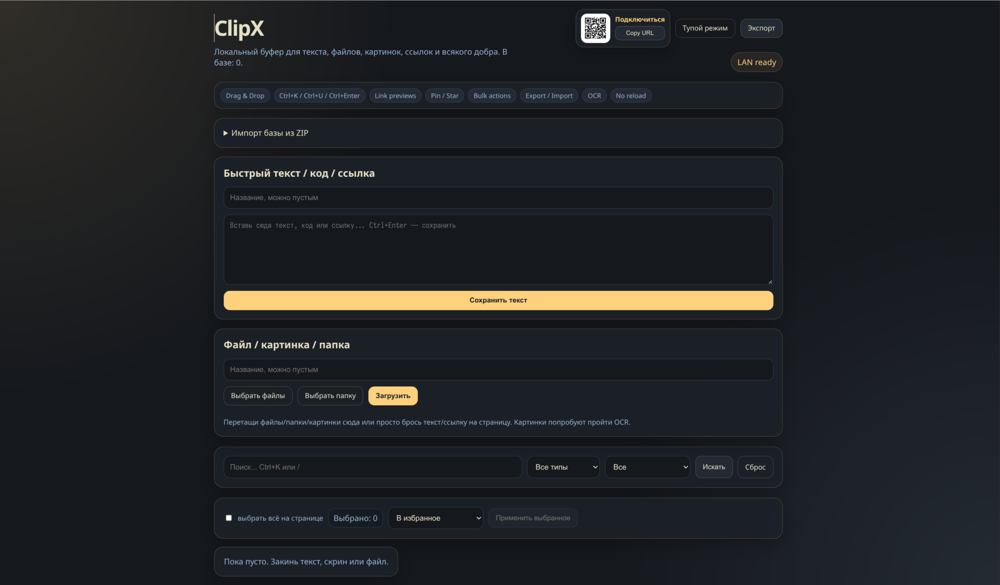
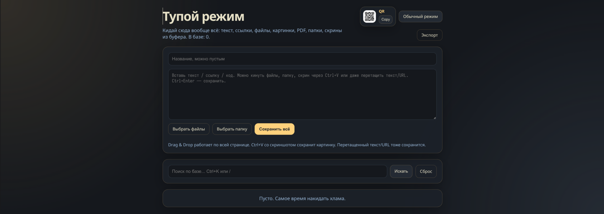
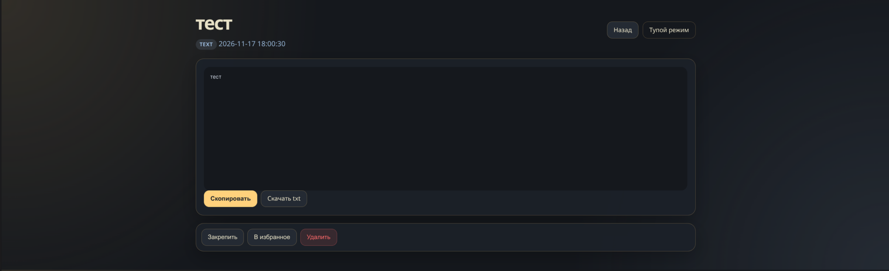

# ClipX

<div align="right">
  <a href="README.md"><strong>English</strong></a> ·
  <a href="README.ru.md">Русский</a>
</div>

[](https://www.python.org/)
[](https://flask.palletsprojects.com/)
[](LICENSE)
[](https://smetaha.github.io/ClipX/)

ClipX is a local-first clipboard manager for text, links, files, images, and OCR-powered notes.

It helps you keep everything you regularly copy, save, or reference in one private workspace: text snippets, URL bookmarks, code, screenshots, PDFs, and image-based OCR results.

## Why ClipX

- local and private: your data stays on your machine
- fast input: paste, drag & drop, upload files and folders
- search and filters across item types and statuses
- pin and favorite important records
- OCR for extracting text from screenshots and images
- QR / LAN access for local sharing on your network
- import/export for backups and migrations

## What the project does

- save text, links, and code snippets
- store files, screenshots, and PDFs
- mark favorite and pinned items
- build automatic link previews
- extract text from images using OCR
- work in both full and simplified modes
- search and filter records by type and status
- import and export backups
- access the app through QR and local LAN URLs

## Screenshots

### Main interface

<div align="center">
  
</div>

### Simple mode

<div align="center">
  
</div>

### Buffer item card

<div align="center">
  
</div>

## Tech stack

- Python 3.11+
- Flask
- SQLite
- Pillow
- Tesseract OCR
- QR code generation

## Quick start

### 1) Install dependencies

```bash
python -m venv .venv
source .venv/bin/activate
pip install -r requirements.txt
```

### 2) OCR on Linux

```bash
sudo apt update
sudo apt install tesseract-ocr tesseract-ocr-rus tesseract-ocr-eng
```

### 3) Run the app

```bash
python app.py
```

Open it in a browser:

```text
http://localhost:5050
```

## Environment variables

```bash
CLIPX_PORT=5050 python app.py
CLIPX_PUBLIC_URL=http://192.168.1.25:5050 python app.py
CLIPX_HOST_IP=192.168.1.25 python app.py
```

## Project structure

```text
ClipX/
├── app.py
├── requirements.txt
├── README.md
├── README.ru.md
├── README.en.md
├── SECURITY.md
├── SECURITY.ru.md
├── LICENSE
├── Procfile
├── .env.example
├── Dockerfile
├── docker-compose.yml
├── render.yaml
├── railway.json
├── docs/
│   └── index.html
├── deployment/
│   ├── README.md
│   ├── README.ru.md
│   └── README.en.md
├── static/
├── templates/
├── data/
├── .github/workflows/pages.yml
├── .gitignore
└── .dockerignore
```

## Docs and links

- [README.md](README.md)
- [README.ru.md](README.ru.md)
- [SECURITY.md](SECURITY.md)
- [SECURITY.ru.md](SECURITY.ru.md)
- [deployment/README.md](deployment/README.md)
- [deployment/README.ru.md](deployment/README.ru.md)
- [deployment/README.en.md](deployment/README.en.md)

## Deployment

The repo includes configuration for:

- local Docker deployment
- VPS/server deployment
- Render
- Railway

More details: [deployment/README.en.md](deployment/README.en.md)

## GitHub Pages demo

Live preview:

- [GitHub Pages](https://smetaha.github.io/ClipX/)

The file `docs/index.html` is a static preview of the actual app UI, built from the project's real HTML/CSS source in `templates/` and `static/` without inventing unrelated functionality.

## License

This project is distributed under the MIT License. See [LICENSE](LICENSE).

## Security

Please review [SECURITY.md](SECURITY.md) before reporting a potential vulnerability.
